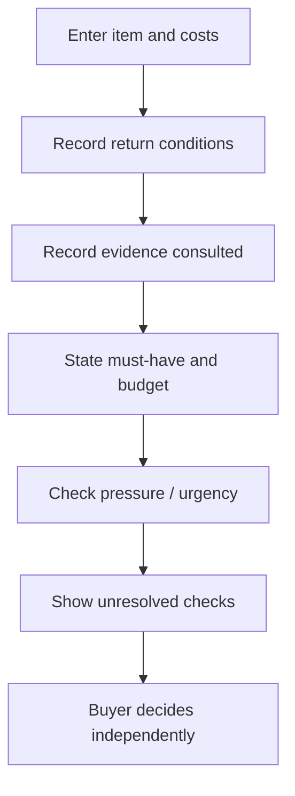

# PACKET — Week 10: Compra con Calma

## Slice and role
**Role:** buyer-side autonomy and regret-prevention pre-checkout check.  
**Working name:** Compra con Calma.  
**Primary user:** a buyer in Mexico who is close to paying and wants to avoid preventable regret without being told what to buy.

## Problem / vacuum
At the moment before payment, a buyer may have fragmented information about total cost, return conditions, product fit and evidence quality. The MVP helps the buyer pause and organize unknowns around their own must-haves. It does not claim to verify a seller or predict regret.

## Exact MVP
1. Enter product/service name and advertised price.
2. Add shipping and extra charges; show the sum in MXN.
3. Record the buyer's understanding of return conditions.
4. Record the type of evidence consulted.
5. Capture the buyer's non-negotiable requirement.
6. Ask the buyer to check budget fit and pressure/urgency.
7. Generate a checklist of unresolved items and an autonomy-preserving next step.
8. Keep all inputs client-side; no account, seller ranking, commission, purchase link, or recommendation engine.

## User flow
Open page → enter purchase context → mark terms/evidence/budget/pressure → review summary → see missing checks → return to edit or use checklist independently. The interface never chooses “buy” or “don't buy” for the user.

## Data model
Client-side form state only: item (string, max 100), priceMXN (non-negative number), extrasMXN (non-negative number), returnStatus (unknown/limited/clear/none), evidenceType (none/seller/independent/docs), mustHave (string, max 240), budgetFits (boolean), pressureFree (boolean). No persistence or server submission.

## Pages / screens
- /week10: Next.js shell hosting the prototype.
- /compra-con-calma/index.html: responsive pre-checkout form, cost summary and checklist result.

## Stack
| Layer | Choice | Reason |
|---|---|---|
| UI shell | Next.js 15 / React 19 / TypeScript | Existing repository baseline |
| Interaction | Static HTML/CSS/vanilla JS | Small, inspectable MVP without dependencies |
| Data | Browser memory only | Minimize privacy and retention risk |
| Hosting | Existing Vercel-linked GitHub repository | Reuse deployment path |

## Safety floor / exclusions
- No seller/store recommendation engine, ranking, affiliate links or commissions.
- No automated truth, authenticity, legal compliance or seller-reliability claims.
- No purchase execution, payment blocking or coercive recommendation.
- No accounts or persistent personal data.
- Evidence labels describe what the buyer says they consulted; they are not verification badges.
- Total is arithmetic on user-entered values, not a quote or guarantee.

## Benchmark line
The project brief's benchmark families include evidence methods (AskCR / Which? / PROFECO), fit mechanisms (True Fit / Zalando), and review governance (Trusted Shops / BBB). This MVP borrows only the general idea of evidence transparency and buyer comprehension; it does not claim equivalence, affiliation, current Mexico coverage, or a validated best solution.

## Mermaid flow

## Mechanical test plan
- Price 1000 + extras 100 displays MXN $1,100.
- Unknown return policy adds a return-policy check.
- No evidence or seller-only evidence adds an evidence check.
- Budget unchecked adds a budget check.
- Pressure-free unchecked adds a pause/pressure check.
- Missing item or price is called out.
- Result never says seller is verified or instructs user to buy.
- Inputs are not submitted to a backend; refresh clears form values.
- Mobile layout stacks form and summary without horizontal overflow.

## Persona test protocol
Use a fresh session and ask a participant to check a real or fictional purchase. Do not coach. Record whether they can explain total cost, what remains unknown, and that the tool does not decide for them. Log actual confusion, fix the worst issue, and retest. Do not claim this test passed until it has been run.

## Scope cut
Deferred: retailer integrations, external policy verification, evidence citations, accounts, purchase history, price tracking, and recommendation/ranking logic.

## Long view
A trustworthy pre-checkout layer could make costs, evidence and trade-offs behind everyday purchases easier to understand. It should help people act on their own priorities rather than optimize conversion or direct demand to a seller. Expansion is justified only if comprehension tests show buyers understand uncertainty better and feel more—not less—in control.
