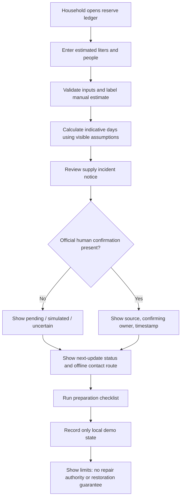
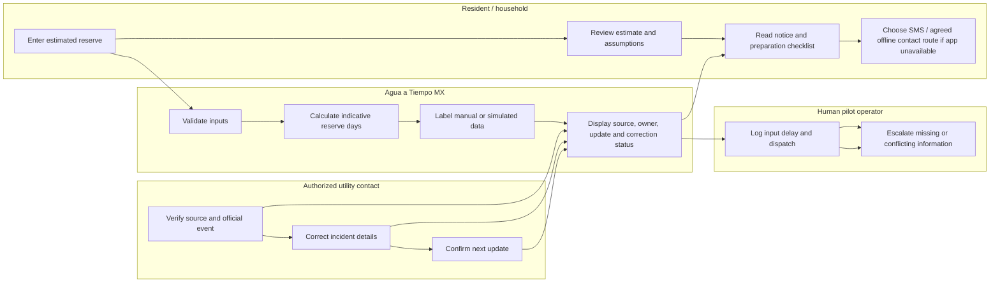

# BUSINESS BENDING · WEEK 11 — PACKET
## Agua a Tiempo MX · Regina / USER

**Working slice:** private household reserve ledger + supply-incident notice workflow + preparation check.
**Status:** prototype; all displayed readings and incidents are synthetic and labeled.

## 1. Problem in my own words
Households can know that water cuts happen without knowing how much water they actually have left, whether a notice is official, who owns the next update, or what they should prepare for. A reserve estimate alone does not create water, authorize repairs, or prove that municipal supply will return. This slice connects an editable household reserve estimate to an accountable incident record while keeping uncertainty visible.

## 2. Exact user
The primary user is a household member in Mexico City who stores water in buckets, a cistern, or a rooftop tank, uses a phone or a shared/offline contact route, and needs to plan bathing, cooking, drinking, and cleaning around an uncertain supply interruption. The user may have no smartphone, no reliable storage measurement, or no clean reading; basic notices must still be accessible without a fee or mandatory app. The prototype uses invented household data only.

## 3. Success definition
Before the module closes, a user can (1) edit a household reserve estimate and household size, (2) see a transparent, approximate reserve-days calculation, (3) distinguish a simulated notice from a verified official event, (4) inspect the source, owner, last update and next update status, and (5) complete a short preparation check without the interface inventing a cause, restoration time, water-quality claim, or AI prediction.

## 4. Working flow (Mermaid)

## 5. Actor swimlane (Mermaid)

## 6. Benchmark line
**Best existing solution pattern:** PUB's Smart Water Meter program and WINT's water-intelligence/leak-prevention platform are relevant reference points for metering, visibility and operational response; they are not proof of impact for this Mexican household pilot.
**Difference/localization:** Agua a Tiempo MX starts with a low-cost, manually editable household reserve ledger and an accountable notice/correction workflow, with an offline/SMS shadow route and explicit uncertainty labels rather than requiring new hardware or promising that visibility causes repairs.

## 7. Long view (three years)
If this slice works, Agua a Tiempo MX could become a utility-funded household water-readiness service that connects reserve estimates, authorized incident notices and accountable follow-up across participating neighborhoods. A later version could integrate approved utility feeds and optional low-cost sensors, while preserving manual estimates and offline access for households excluded by technology. Expansion would depend on measured notice timeliness, comprehension, preparation, false alarms, excluded households and full cost—not assumed savings or an invented 10:1 return.

## 8. Scope cut
Not building: new physical sensor hardware, autonomous repair dispatch, public household maps, paid resident membership, mandatory app access, public-network repair coverage, water-quality certification, cause prediction, restoration-time prediction, AI incident confirmation, real SMS sending, live utility integrations, or production personal-data storage. No field spending before a utility contact accepts verification, correction and escalation responsibilities.

## 9. Architecture + stack
| Layer | This slice |
|---|---|
| UI | Next.js 15 / React 19 shell; accessible responsive HTML/CSS/JS interface |
| IoT / sensing | Phone-as-input/manual reading; clearly labeled simulated sensor feed in demo |
| ML | Simulated classification/explanation label only; deterministic rules calculate reserve days; no prediction or authority claims |
| Third stack | Geodata: schematic service-zone placeholder and incident location labels; no public household map |
| Marketplace / workflow logic | Incident source-owner-status-update ledger and correction/escalation state |
| Data | Browser-only demo state; no personal data persisted to server |
| Auth / RLS | No server-side personal data stored in this prototype; if persistence is added, Google Supabase Auth and per-user RLS are required before launch |
| Hosting | Existing Next.js GitHub project / Vercel |
| Secrets | No secrets in client or repository; no API key required |

## 10. Security and Blueprint conditions
- Shadow clause: no resident fee or mandatory app for basic notices; SMS and agreed offline contact route are part of the documented service design. Prototype does not actually send SMS.
- Truth: all manual estimates, simulated readings and simulated notices are visibly labeled; official confirmation requires an authorized human.
- Operational authority: no field spending or repair promises; household repairs are separate from public-network work.
- Timeliness: interface records notice time, source/owner, correction status and next update; 12-hour scheduled-notice target is a pilot metric, not a claimed result.
- Privacy: no account, real personal data, public household map, or server-side storage in this demo.
- Evidence: targets are measured only with real denominators; no real event means inconclusive, not success.

## 11. Test plan
1. Input validation: blank, negative, non-numeric, and implausibly high liter/person values are rejected or constrained with a clear error.
2. Calculation: reserve days equal liters divided by household people and the visible per-person daily planning assumption; result is labeled indicative.
3. Truth labels: simulated notice and simulated sensor states are visible on every relevant screen.
4. Authority: an unconfirmed notice cannot display as official; no restoration time or cause is generated.
5. Privacy: demo uses fictional data only and stores no data server-side.
6. Accessibility: keyboard focus, labels, contrast, mobile layout, and plain Spanish are checked.
7. Mechanical pass: run the test plan, record at least one observed bug, fix it, and redeploy.
8. Persona pass: test screenshots in a fresh chat with a synthetic resident persona; log hesitation, confusion, abandonment risk and the fix. Do not claim the persona test happened until performed.

## 12. Acceptance criteria
- A visitor can edit reserve liters and household size and receive an indicative calculation.
- A visitor can distinguish a simulated incident from a confirmed official notice.
- Each incident view shows source status, owner status, last update and next update.
- Preparation checklist is usable on a phone and by keyboard.
- No real personal data, secret, public household map, or misleading AI prediction is included.
- README, implementation prompt, test log, persona log, demo script and session-close decisions are committed.
