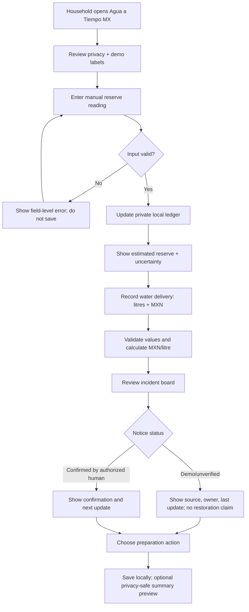
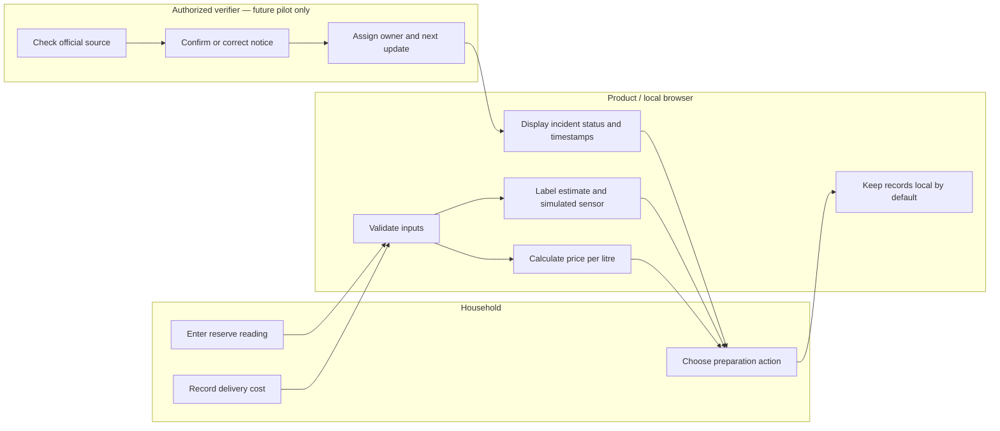

# BUSINESS BENDING WEEK 11 — PACKET
## Agua a Tiempo MX · Household Water Tools
**Owner / role:** Regina — USER  
**Weekly project:** When Scarcity Ends — And What We Lose Anyway

## 1. Problem in my words
A household can know its tank is nearly empty and still have no reliable way to know when public water will return, what a delivery actually cost per litre, or whether a reported cut is official. The product does not create water or fix the network. It connects a private reserve/delivery ledger to verified supply-incident notices and accountable follow-up, so people can prepare without being charged for public-service failure.

The Week 11 Blueprint is the source of scope and constraints. Valeria's reported household experience (MX$3,000 bimonthly, about four street-wide cuts yearly, and insufficient stored water for bathing) is one household observation, not a population estimate.

## 2. Exact user
Primary user: an adult household member in a water-insecure area of Iztapalapa who tracks tank/reserve levels and sometimes pays for delivered water. They may have limited data access, distrust apps, or share a phone. Basic notices must not require a smartphone, storage capacity, a clean reading, or payment.

Secondary actor: a designated utility/community notice verifier who can confirm, correct, or update an incident. The prototype demonstrates the handoff; it does not claim a real utility has agreed to participate.

## 3. Success definition
**Before the module closes, a household can enter an estimated reserve reading and a water delivery, see a clearly labelled estimate and price per litre, review a sample incident notice whose status and source are explicit, and record a preparation action.** The interface must never present demo incidents as real, promise restoration, infer water quality, or imply a repair has been authorized.

Pilot-level success targets from the Blueprint (not proven outcomes): ≥90% of eligible scheduled notices at least 12 hours early; ≥80% comprehension in a sample; ≥70% preparation among households able to prepare. Report denominators. If no real event occurs, the result is inconclusive.

## 4. Working slice
1. Private household reserve ledger: manual entry first; date, estimated litres, optional note. Sensor input is simulated and labelled as simulated.
2. Delivery record: date, estimated litres, total MXN cost; calculate MXN/litre only when both volume and cost are valid.
3. Incident board: synthetic sample notice with source, owner, status, last update, and next update. A notice is labelled “DEMO / DATOS SIMULADOS”; only an authorized human could confirm official events in a real pilot.
4. Preparation checklist: household records what it can do; no score that shames people who cannot prepare.
5. Export/share preview: only a user-initiated summary with no household location or identifying data by default. The MVP stores no personal data server-side; data remains in local browser state and may be lost when cleared.

## 5. Generated mockup requirement
The primary screen is a mobile-first dashboard: warm off-white background, deep blue-green headings, a large “Reserva estimada” card with litres and a clear “estimación manual” label, a compact “Registrar lectura” action, a delivery-cost card with MXN/litre, and an incident card with status/source/last update. A bottom privacy note says “Tus registros son privados en este dispositivo”. Any sensor/ML output is marked “SIMULADO — no es medición real ni predicción oficial.”  
**Mockup asset:** create a static screen mockup in the repository as `public/week11/agua-a-tiempo-mockup.svg` (editable illustrative UI, not a screenshot of a running product). This is a design reference, not evidence of real measurements.

## 6. Benchmark line
**Best existing solution on Earth:** Singapore PUB’s Smart Water Meter program is a strong household-facing benchmark for usage visibility and unusual-consumption alerts; WINT is a relevant commercial benchmark for detecting abnormal water use/leaks in buildings.  
**Mine differs/localizes by:** Agua a Tiempo MX focuses on intermittent supply, household reserves and pipa deliveries, plus accountable notices and an offline/SMS route, without claiming that household sensing fixes municipal network losses.

## 7. Long view — three years
If the slice works, Agua a Tiempo MX could become a utility-funded preparation and incident-follow-up layer connecting household reserve records with verified supply events. It could support opt-in aggregated evidence about interruption duration and preparation gaps, while keeping household-level data private. Expansion would depend on real event data, accessible notice delivery, independent review of false alerts and costs, and a verified utility contact—not on demo engagement alone.

## 8. Scope cut
- No awareness campaign or recycling-tips app.
- No real sensor integration in this slice; any sensor stream is simulated and labelled.
- No unverified live outage feed, invented restoration time, cause, water-quality statement or AI prediction.
- No automatic repair dispatch, field spending, pooled repair membership or resident fee.
- No public household map, sale of personal data, service denial or penalties based on low/missing readings.
- No user accounts or server-side storage in this static MVP; if personal data is persisted later, Google sign-in and Supabase RLS become required before shipping.

## 9. Architecture + stack

| Layer | Choice | Purpose / honesty |
|---|---|---|
| UI | Next.js 15, React 19, TypeScript, Tailwind | Mobile-first Spanish dashboard |
| IoT / sensing | Manual reserve readings + clearly labelled simulated sensor feed | Demonstrates sensing pathway without claiming hardware exists |
| ML | Deterministic, explainable heuristic for low-reserve trend / anomaly flag | “ML-style demo” only; not trained, not predictive, never official |
| Third layer | Marketplace-style unit-cost calculation for deliveries | Transparent MXN/litre comparison; no actual seller marketplace |
| Geodata | No household geolocation in MVP | Avoids exposing household locations; incident geography is coarse and synthetic |
| Storage | Client-side state only | No personal server-side records; user may lose data by clearing browser |
| Tests | Manual mechanical checklist + synthetic persona pass | Document failures and fixes; no fabricated real-user validation |
| Hosting/source | Vercel + GitHub | Free-tier deployment; no secrets in repo |

## 10. Mermaid flow

### Swimlane — who does what

## 11. Test plan
Mechanical pass:
1. Submit empty/negative/too-large reserve values; reject with clear inline errors.
2. Submit delivery with missing or zero litres/cost; do not calculate price per litre.
3. Valid delivery of 500 L for MX$400 must show MX$0.80/L.
4. Confirm every synthetic notice has a visible DEMO label, source, status, timestamp and next update.
5. Confirm “unknown” or “unverified” notice never displays a restoration estimate or water-quality claim.
6. Verify privacy copy; no address, phone, household map, server write or tracking SDK.
7. Find at least one defect, fix it, document the before/after, and redeploy.

Persona pass: synthetic user “Doña Mari”, 54, sells food outside the metro, uses WhatsApp but distrusts apps, reads slowly and may abandon silently. Walk through screenshots in order. Log hesitation, misunderstood labels, and any dead end; fix the most serious confusion. Do not claim a real user test.

## 12. Security floor + Blueprint conditions
- No secrets in code/repository.
- No personal server-side storage in this MVP. If persistence or accounts are added, Google auth + Supabase RLS are blocking requirements.
- Inputs have length/type/range validation.
- Only synthetic sample data, visibly labelled.
- Basic notices must be free and have an SMS plus agreed offline-contact route in the proposed pilot; no mandatory app.
- Manual estimates, stale data and uncertainty remain explicit.
- No field spending until a utility contact accepts source verification, corrections and escalation.
- Household maintenance is separate from public-network work.
- Privacy by default; consented aggregates only; no sale, public household map, denial or penalties based on low/missing readings.

## 13. Open risks / kill criteria
The product is not validated by a working demo. If households cannot act on the information, if notices cannot be verified by an accountable utility contact, if the product excludes people without smartphones/storage, or if false alerts and full operating costs outweigh preparation benefits, stop or redesign. A 10:1 financial return is unproven; the Blueprint’s MX$15,000 pilot cap and MX$150,000 attributable-benefit threshold are hypotheses, not achieved results.
